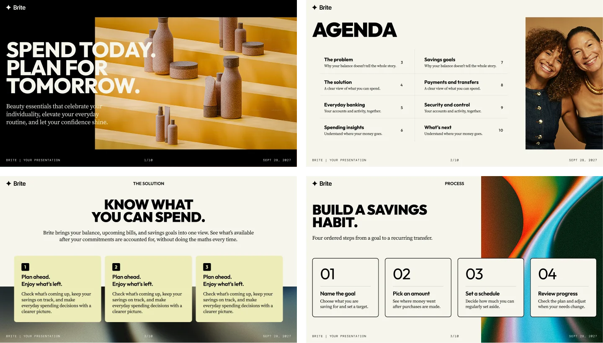

<p align="left">
  <picture>
    <source media="(prefers-color-scheme: dark)" srcset="docs/assets/slidebaby-white.svg">
    <source media="(prefers-color-scheme: light)" srcset="skills/slidebaby/assets/templates/brite/studio/assets/ui/slidebaby.svg">
    
  </picture>
</p>

# Slidebaby — AI presentation and pitch deck generator

Slidebaby is a free AI skill for Codex and Claude. Turn your text, notes or a webpage
into presentations and pitch decks, with designed slide templates, an HTML preview
and a matching PDF. Ask for changes in the same conversation.

Brite is its first visual template, with its own typography and layout library.

[Po polsku](docs/README.pl.md) · [Install](#install) · [Get started](#get-started) · [License](#license)



*Illustrative template content. Brite is the template; Slidebaby is the tool.*

## What you can make

- **Pitch decks:** introduce a startup, product or business idea through its problem, solution, evidence and next steps.
- **Client presentations:** explain a proposal, compare options or present project results.
- **Product presentations:** turn product notes or a webpage into a focused slide deck.
- **Reports and team updates:** present your metrics, progress, process or roadmap.

[Try a pitch deck prompt or another example](docs/EXAMPLES.md).

## What you can do

- Let your agent organize rough notes or preserve your finished copy exactly.
- Choose from **69 layout variants in 14 families**, with Light and Dark per slide.
- Search the library by name or use case, or let the agent select layouts.
- Add your logo, photographs and screenshots. Large raster images become proportional WebP copies; original files stay intact.
- Revise the same project. Supported layout changes preserve your wording; overflow can produce a concrete proposal for your approval.
- Present in a browser, download the prepared PDF and use local Live preview where the host permits it.

Slidebaby runs through an agent that can read files and execute local scripts.
It is not a standalone browser editor. English/Polish interface language is independent of slide content.

[How visual templates are organized](docs/TEMPLATES.md). More visual templates
can be registered under the same skill; this release includes Brite only.

## Install

[View Slidebaby on skills.sh](https://skills.sh/danielmansz/slidebaby/slidebaby) for the Skills CLI install command.

### Codex

Ask the skill installer in your project:

```text
$skill-installer install the skill into this project at .agents/skills/slidebaby from
https://github.com/danielmansz/slidebaby/tree/v1.2.0/skills/slidebaby
```

Or download **slidebaby-skill-v1.2.0.zip** from [Releases](https://github.com/danielmansz/slidebaby/releases),
unzip it, and put the complete `slidebaby` folder in your project's `.agents/skills/` directory.
If you downloaded the full source repository, copy `skills/slidebaby` from inside it.
Keep all files, not just SKILL.md. Select `$slidebaby`; restart the session if it has not appeared.

### Claude

In a Claude account with custom Skills and code execution available, upload
**slidebaby-skill-v1.2.0.zip** using **Customize → Skills → + Create skill → Upload a skill**,
then enable it. Upload the skill ZIP, not the repository/source ZIP.
For Claude Code, the same complete folder can be placed in `.claude/skills/slidebaby`.

[Installation details, updates and troubleshooting](docs/INSTALLATION.md)

## Get started

Choose Slidebaby in your agent and use one of these three requests:

1. **Explore:** “Open an empty presentation and show me the templates.”
2. **Try it:** “Create a three-slide sample presentation with photos, an HTML preview and a PDF.”
3. **Use your material:** “Create a presentation from the material below for [audience]. Aim for [number] slides. [Keep my wording / You may organize and shorten it].”

For the third option, paste your text/notes, attach readable material, or provide a webpage URL.
The webpage workflow uses that one page; it does not crawl the whole website.
Logo and photos are optional. [More example prompts](docs/EXAMPLES.md).

You receive **HTML**, **PDF** and an editable project. Ask for revisions in the same chat.
An optional project ZIP is for backup/transfer; you do not need to unpack it to keep editing in that chat.

## Requirements and viewing

- **Create/export PDF:** existing Node.js 20+, Playwright, pdf-lib and a compatible Chrome, Edge or Chromium where the agent runs. These are not bundled; the skill checks first and does not install automatically.
- **View completed HTML:** a modern browser. Safari/Firefox can view HTML; they are not this skill's PDF renderer.
- **Live preview:** a bounded local Node process started for your chosen project. A remote/cloud chat cannot open your desktop browser or keep downloaded files synchronized.
- **No model API key for the helpers:** they do not call a model API. Access to your agent, its usage limits and any other host costs are separate.

Locally, use the current live URL or refresh the same updated HTML file. After cloud edits,
download the new HTML/PDF snapshots. [How viewing and files work](docs/INSTALLATION.md#viewing-and-later-edits).

## Scope and tested environments

Brite covers Cover, Agenda, Content, Feature cards, Section opener, Figure & caption,
Gallery, Metrics, Quote, Comparison, Process, Roadmap, Table and Summary.

This release includes source/edit replay checks and measured fit. Text is not silently clipped,
rewritten or shrunk; smaller card body text needs your explicit permission and changes the whole row.
The agent still needs to inspect the exported pages for contrast and editorial quality.

Local macOS/Chrome exports, offline HTML, project transfers and independent agent scenarios were tested.
Windows/Linux paths have code checks; this is not a clean-machine certification of every host.
Earlier Claude feedback informed delivery, but this exact release was not rerun in a new Claude account.

Original-layout PPTX/PDF import, native charts, arbitrary fonts/themes and unrestricted component mixing
are outside scope. Attachments can supply content only when your agent can actually read them.
See [release notes](RELEASE_NOTES.md) for current limits.

## License

**Free presentation creation, including paid client work. No resale of the skill or modified versions.**

PDF, HTML and actual editable presentation projects may be delivered to clients for a fee.
Free forks retain notices and identify modifications. The custom
[Slidebaby Community License 1.0](LICENSE) is source-available, not an OSI-approved open-source license.
[English/Polish explanation](LICENSING.md) · [Third-party terms](THIRD_PARTY_NOTICES.md) · [Visual/font credits](CREDITS.md).

Created and designed by [Daniel Mansz](https://www.linkedin.com/in/daniel-mansz/).

## Contribute and build

[Report an issue](https://github.com/danielmansz/slidebaby/issues) with a minimal non-sensitive example,
your host/OS and the actual error. [Contributor checks](CONTRIBUTING.md) · [Prepare release archives](docs/RELEASING.md).
