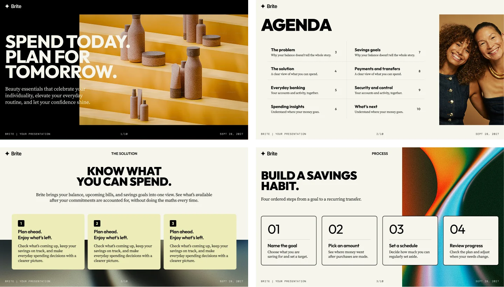

# Slidebaby

**Prezentacje i pitch decki tworzone z pomocą agenta AI.**

Slidebaby to darmowy skill dla Codexa i Claude’a. Przekaż tekst, notatki albo adres
strony, żeby stworzyć prezentację lub pitch deck. Agent dobierze układy Brite, przygotuje
podgląd HTML i PDF, a kolejne poprawki zapisze w tym samym projekcie.
[English](../README.md) · [Licencja](../LICENSE)



## Co możesz przygotować

- **Pitch deck:** przedstaw startup, produkt lub pomysł biznesowy — problem, rozwiązanie, dane i kolejne kroki.
- **Prezentację dla klienta:** pokaż propozycję, porównaj opcje lub podsumuj wyniki projektu.
- **Prezentację produktu:** ułóż slajdy z notatek albo treści strony internetowej.
- **Raport lub aktualizację dla zespołu:** przedstaw wskaźniki, postępy, proces lub roadmapę.

[Przykładowe prośby do agenta, w tym pitch deck](EXAMPLES.md).

## Instalacja

**Codex:** poproś instalator skilli:

```text
$skill-installer zainstaluj skill w tym projekcie w .agents/skills/slidebaby z
https://github.com/danielmansz/slidebaby/tree/v1.0.0/skills/slidebaby
```

Możesz też pobrać `slidebaby-skill-v1.0.0.zip` z
[Releases](https://github.com/danielmansz/slidebaby/releases), rozpakować i umieścić
cały folder `slidebaby` w `.agents/skills/` swojego projektu.
Jeśli pobierasz całe źródła repozytorium, skopiuj folder `skills/slidebaby` z jego wnętrza.
Wywołaj `$slidebaby`. Jeśli nie widzisz skilla, rozpocznij nową sesję.

**Claude:** jeśli masz dostępne własne Skills i wykonywanie kodu, prześlij ten sam
ZIP przez **Customize → Skills → + Create skill → Upload a skill** i włącz skill.
Nie przesyłaj ZIP-a całego repozytorium ani samego SKILL.md.
W Claude Code cały folder można umieścić w `.claude/skills/slidebaby`.

## Zacznij na jeden z trzech sposobów

1. **Przejrzyj bibliotekę:** „Otwórz pustą prezentację i pokaż szablony”.
2. **Przetestuj przykład:** „Przygotuj trzy przykładowe slajdy ze zdjęciami, HTML i PDF”.
3. **Użyj swoich materiałów:** „Ułóż prezentację z poniższych notatek dla [odbiorcy], około [liczba] slajdów. [Zachowaj tekst / Możesz go uporządkować i skrócić]”.

Wklej treść, dołącz czytelny plik albo podaj stronę internetową. Analizowana jest
jedna wskazana strona. Logo i zdjęcia możesz dodać później. Język interfejsu EN/PL
nie zmienia języka Twoich tekstów. [Przykładowe poprawki](EXAMPLES.md).

## Co otrzymasz

- HTML do przeglądania i prezentowania oraz odpowiadający mu PDF.
- Edytowalny projekt, do którego wracasz przez rozmowę z agentem.
- Opcjonalny ZIP jako kopię/przeniesienie. Nie musisz go pobierać ani rozpakowywać,
  aby kontynuować pracę w tym samym czacie.

Biblioteka ma 69 wariantów w 14 rodzinach. Możesz wyszukiwać po nazwie lub zastosowaniu,
łączyć Light/Dark i zmieniać zgodne układy bez utraty tekstu. Przy przepełnieniu
agent może zaproponować konkretny podział do akceptacji. Zmniejszanie fontu w kartach
wymaga Twojej zgody; dotyczy całego rzędu.

## Wymagania i podgląd

Eksport PDF wymaga istniejących Node.js 20+, Playwright, pdf-lib i zgodnego
Chrome/Edge/Chromium w środowisku agenta. Skill sprawdza narzędzia i nie instaluje
ich automatycznie. Samodzielny HTML można oglądać także w Safari/Firefox.
Pomocnicze skrypty nie wymagają klucza API modelu; dostęp i koszty samego agenta są osobne.

Lokalnie Live preview może odświeżać tę samą kartę po zapisaniu sprawdzonych zmian.
Bez niego odśwież aktualizowany HTML. Po edycji w chmurze pobierz nowe pliki:
pobrana kopia nie synchronizuje się z czatem. [Szczegóły instalacji i podglądu](INSTALLATION.md).

Odtwarzanie oryginalnego wyglądu PPTX/PDF, natywne wykresy, dowolne fonty/motywy
oraz swobodne mieszanie komponentów pozostają poza zakresem.
Odczyt załączników zależy od możliwości Twojego agenta.

## Zasady korzystania

Możesz bezpłatnie tworzyć prezentacje, również odpłatnie dla klientów, i przekazywać
PDF, HTML oraz rzeczywiste edytowalne projekty. Odsprzedaż samego skilla i jego
przerobionych wersji jest zabroniona. Darmowe forki zachowują informacje o autorze
i licencję. Zdjęcia i fonty mają odrębne warunki.

[Pełna licencja](../LICENSE) · [Wyjaśnienie EN/PL](../LICENSING.md) · [Źródła materiałów](../CREDITS.md)

Projekt i design: [Daniel Mansz](https://www.linkedin.com/in/daniel-mansz/).

## Slidebaby i Brite

Instalujesz jeden skill `slidebaby`. Brite jest pierwszym szablonem wizualnym,
z własną typografią, kolorami i biblioteką układów. Kolejne szablony będą mogły
pojawić się w tym samym skillu. Prezentacja zapamiętuje swój szablon; Light/Dark
możesz mieszać między slajdami. [Opis struktury](TEMPLATES.md).
